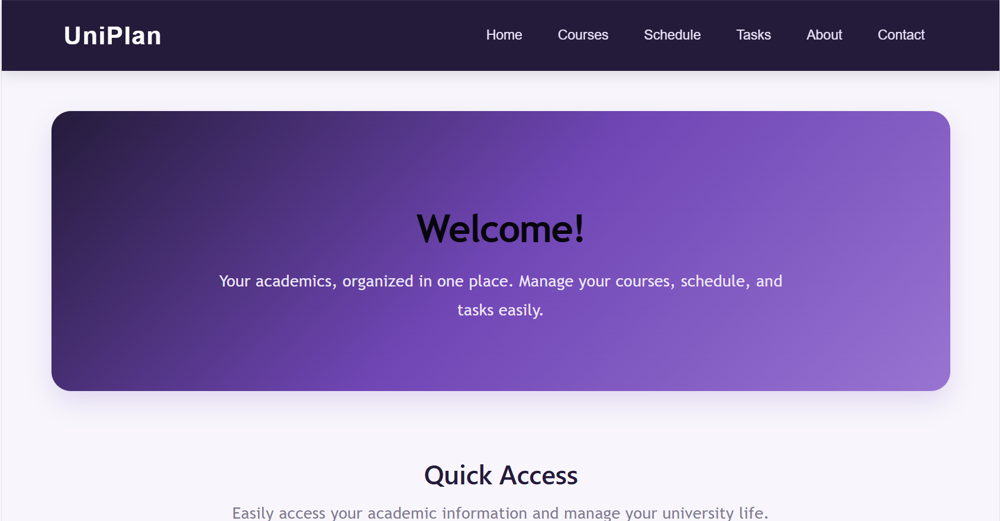
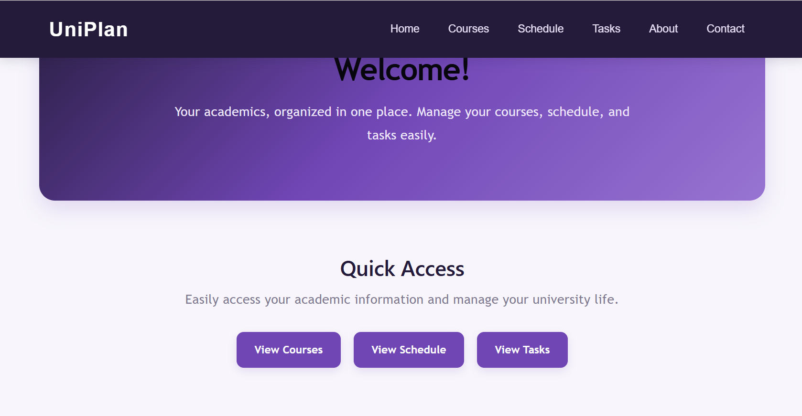
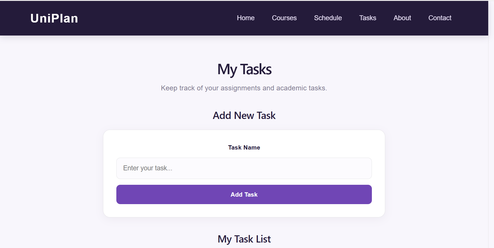
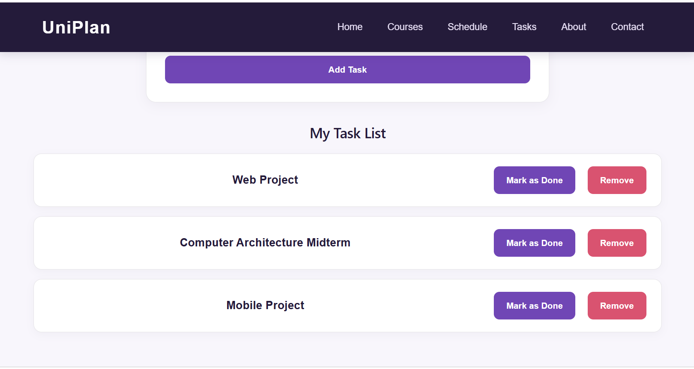
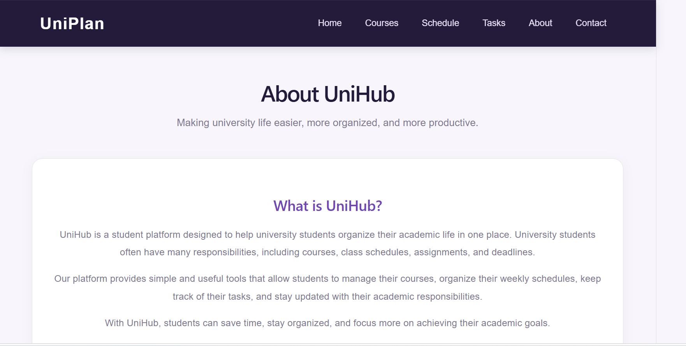
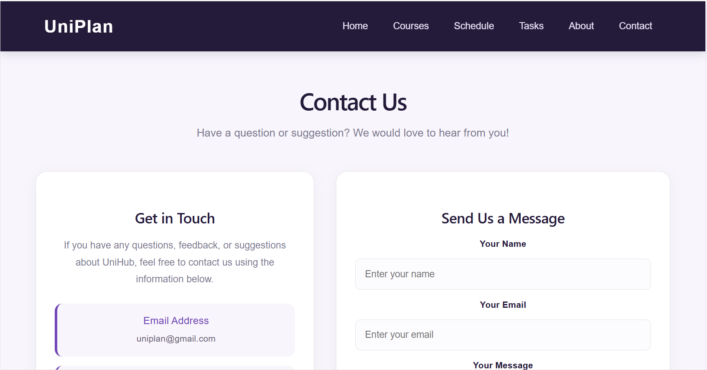
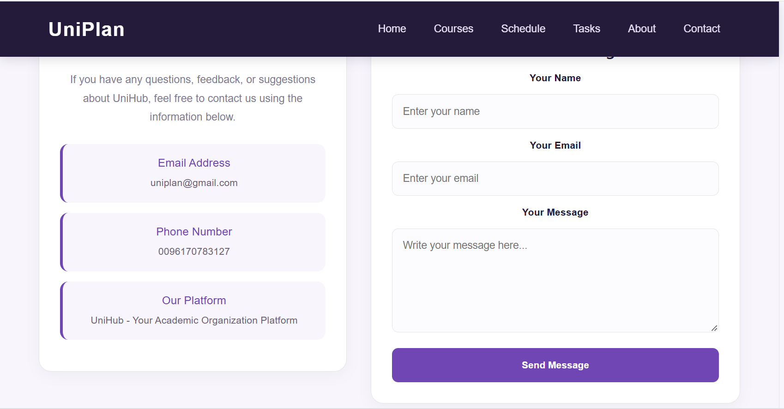
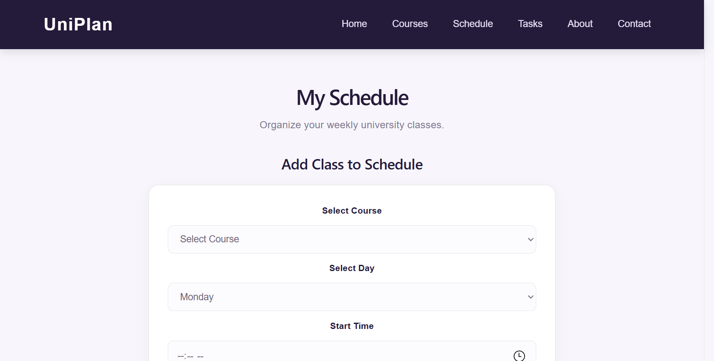
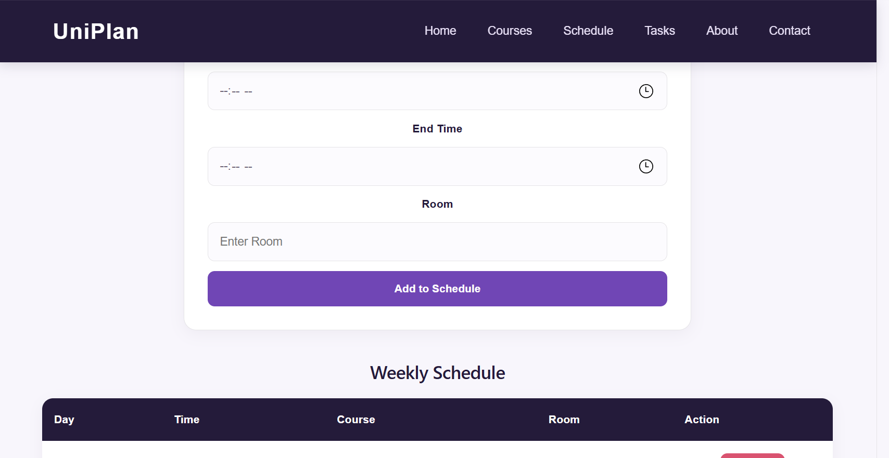

# UniPlan – University Student Planner

## Project Description

UniPlan is a React-based web application designed to help university students organize and manage their academic activities in one place.

The platform provides students with simple tools to manage their university courses, organize their weekly class schedules, and keep track of their academic tasks and assignments.

## Main Features

- **Home Page:** Introduces the platform and provides quick navigation to its main sections.
- **Courses Management:** Allows students to add and remove university courses.
- **Schedule Management:** Allows students to organize their weekly classes by course, day, time, and room.
- **Tasks Management:** Allows students to add tasks, mark them as completed, and remove them.
- **About Page:** Explains the purpose and goals of UniPlan.
- **Contact Page:** Provides a contact form for users.
- **Local Storage:** Saves courses, schedules, and tasks in the browser so that data remains available after refreshing the page.
- **Responsive Design:** Supports desktop and mobile screen sizes.

## Technologies Used

- React.js
- JavaScript
- HTML5
- CSS3
- React Router DOM
- Browser Local Storage
- Vite
- Git and GitHub
- Vercel

## Project Structure

```text
src/
├── components/
│   └── Navbar.jsx
├── pages/
│   ├── Home.jsx
│   ├── Courses.jsx
│   ├── Schedule.jsx
│   ├── Tasks.jsx
│   ├── Features.jsx
│   ├── About.jsx
│   └── Contact.jsx
├── App.jsx
├── App.css
└── main.jsx
```

## Installation and Setup

1. Clone the repository:

```bash
git clone https://github.com/batoulawadi/UniPlan.git
```

2. Navigate to the project folder:

```bash
cd UniPlan
```

3. Install the dependencies:

```bash
npm install
```

4. Start the development server:

```bash
npm run dev
```

5. Open the local URL displayed in the terminal.

## Data Storage

UniPlan uses the browser's Local Storage to save courses, class schedules, and tasks.

This allows users to keep their information after refreshing the page without requiring a backend or database.

## Screenshots

Screenshots of the application will be available in the `screenshots` folder.

## Live Demo

Add your deployed Vercel URL here.

## Repository

https://github.com/batoulawadi/UniPlan


## Screenshots

### Home Page





### Courses Page


### Tasks Page





### About Page




### Contact Page




### Schedule Page




